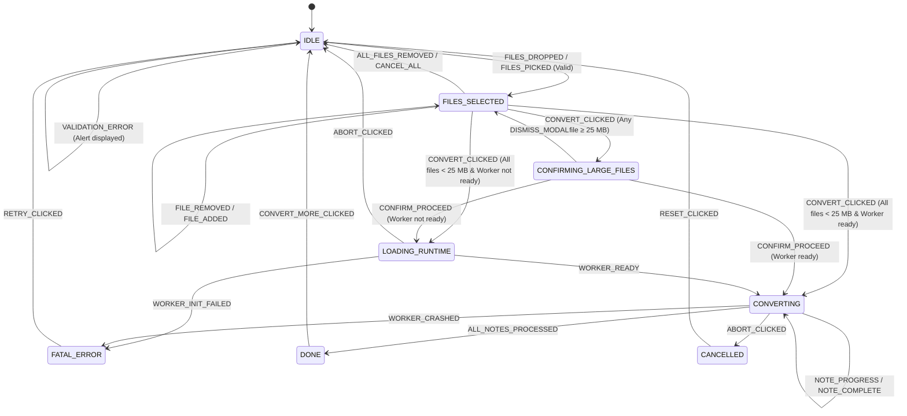

# User Flow, State Machine & Edge Cases — sdocx2obsidian

**Document:** `docs/frontend/USER_FLOW_AND_STATES.md`  
**Status:** Living Design Specification  
**Authority:** Aligned with `docs/frontend/PRODUCT_BRIEF.md`, `docs/frontend/UI_UX_SPEC.md`, and `site/worker.js`

---

## 1. Overview & Architectural Grounding

The `sdocx2obsidian` web frontend operates as a deterministic **Finite State Machine (FSM)**. Every interaction, background worker event, and error condition maps to an explicit state. This architecture prevents asynchronous race conditions, guarantees clean cancellation, and ensures strict adherence to browser memory limits.

---

## 2. Finite State Machine (FSM) Specification

### 2.1 State Definitions

| State Name | UI Presentation | Allowed Actions |
|---|---|---|
| `IDLE` | Drop zone empty, primary file selection button active. Supporting info sections visible. | Drag & drop files, click file picker, toggle theme. |
| `FILES_SELECTED` | Staged file list displayed with file sizes, session total, remove buttons, and "Convert" button. | Add more files, remove individual file, clear all, trigger conversion. |
| `CONFIRMING_LARGE_FILES` | Accessible modal overlay displayed over staged file list, highlighting notes $\ge 25\text{ MB}$. | Confirm (proceed to conversion), Cancel (dismiss dialog back to `FILES_SELECTED`). |
| `LOADING_RUNTIME` | Converter card displays progress bar with status: *"Initializing Python engine..."*. Worker is downloading/instantiating Pyodide & wheel. | Cancel operation. |
| `CONVERTING` | Progress bar active (0%–100%), status text updating per note, note table shows live chips (`Waiting`, `Converting`, `Converted`, `Failed`). | Cancel operation. |
| `DONE` | Success banner, large `[ Download Obsidian Vault (.zip) ]` button, integrated Markdown preview panel, note table with individual statuses. | Download ZIP, switch preview note, copy markdown, convert more notes (reset). |
| `CANCELLED` | Session aborted notice, worker reset. Clean rollback to `IDLE` or `FILES_SELECTED`. | Reset or re-select files. |
| `FATAL_ERROR` | Error banner with recovery action, detailed non-sensitive diagnostic message, GitHub issue link. | Retry initialization, reset session. |

---

### 2.2 Mermaid State Transition Diagram



---

### 2.3 State Transition Matrix

| Current State | Event Trigger | Next State | Side Effects / Actions Taken |
|---|---|---|---|
| `IDLE` | `INPUT_FILES` | `FILES_SELECTED` | Validate file types, count ($\le 5$), individual sizes ($\le 50\text{ MB}$), and session total ($\le 100\text{ MB}$). Store files in staging array. |
| `IDLE` | `INPUT_FILES` (invalid) | `IDLE` | Show inline validation toast/banner (e.g., *"Only .sdocx files supported"*). Discard invalid files. |
| `FILES_SELECTED` | `REMOVE_FILE(id)` | `FILES_SELECTED` (or `IDLE` if empty) | Splice file from array, recalculate session size tally. If array is empty, return to `IDLE`. |
| `FILES_SELECTED` | `CONVERT_TRIGGERED` | `CONFIRMING_LARGE_FILES` | Evaluates if any staged file is $\ge 25\text{ MB}$. If true, open modal with focus trap. |
| `FILES_SELECTED` | `CONVERT_TRIGGERED` | `LOADING_RUNTIME` | If all files $< 25\text{ MB}$ and Worker runtime not yet cached, spawn worker, show initialization progress. |
| `FILES_SELECTED` | `CONVERT_TRIGGERED` | `CONVERTING` | If all files $< 25\text{ MB}$ and Worker runtime already cached, send `start_session`. |
| `CONFIRMING_LARGE_FILES` | `MODAL_CONFIRMED` | `LOADING_RUNTIME` / `CONVERTING` | Close modal, dispatch conversion flow to Web Worker. |
| `CONFIRMING_LARGE_FILES` | `MODAL_DISMISSED` | `FILES_SELECTED` | Close modal, return focus to `[ Convert ]` button. Staged files remain intact. |
| `LOADING_RUNTIME` | `ENGINE_INITIALIZED` | `CONVERTING` | Pyodide ready. Post `start_session` and begin sending individual `convert_note` buffers. |
| `CONVERTING` | `WORKER_NOTE_DONE` | `CONVERTING` | Update per-note chip to `Converted`, update progress bar percentage, cache markdown for preview. |
| `CONVERTING` | `WORKER_NOTE_FAIL` | `CONVERTING` | Mark note chip as `Failed`, record error message, construct safe issue URL. |
| `CONVERTING` | `WORKER_FINISH_SESSION` | `DONE` | Receive generated `vault_zip` blob from worker, populate preview dropdown, trigger success announcer. |
| `CONVERTING` | `USER_ABORT` | `CANCELLED` | Post `abort_session` to worker, terminate worker if unresponsive, set cancel status. |
| `DONE` | `RESET_SESSION` | `IDLE` | Release object URLs (`URL.revokeObjectURL`), clear staged files and preview buffers, render State 1. |

---

## 3. Detailed User Flow Scenarios

### 3.1 Scenario A: Happy Path (Standard Batch Conversion)

1. **Arrival:** User opens the site. The tool is in `IDLE`.
2. **File Selection:** User drags 3 `.sdocx` files (`Biology_Ch1.sdocx` 4.2 MB, `Biology_Ch2.sdocx` 5.1 MB, `Syllabus.sdocx` 0.8 MB) onto the dropzone.
3. **Staging:** App transitions to `FILES_SELECTED`. UI displays:
   - 3 file rows with individual sizes.
   - Aggregate counter: `3 / 5 notes · Total: 10.1 MB`.
4. **Initiation:** User clicks `[ Convert 3 Notes to Obsidian ]`.
5. **Runtime Boot:** App enters `LOADING_RUNTIME`. Status ticker shows: *"Starting Python engine..."*. Worker instantiates Pyodide and loads `sdocx2obsidian` wheel.
6. **Conversion:** Transitions to `CONVERTING`.
   - `Biology_Ch1.sdocx` converts $\rightarrow$ status chip turns green `Converted`.
   - `Biology_Ch2.sdocx` converts $\rightarrow$ status chip turns green `Converted`.
   - `Syllabus.sdocx` converts $\rightarrow$ status chip turns green `Converted`.
   - Progress bar smoothly increments: `33%` $\rightarrow$ `66%` $\rightarrow$ `100%`.
7. **Results (`DONE`):**
   - High-emphasis button appears: `[ Download Obsidian Vault (.zip) — 9.8 MB ]`.
   - Integrated preview panel defaults to `Biology_Ch1.md`. User reads the extracted markdown, confirms embedded image wikilinks (`![[Biology_Ch1_Assets/cell_diagram.png]]`), and clicks `[ Copy Markdown ]`.
   - User switches dropdown to `Syllabus.md` and verifies text.
8. **Export:** User clicks `[ Download Obsidian Vault (.zip) ]`. Browser saves `obsidian_vault.zip`.

---

### 3.2 Scenario B: Large File Memory Confirmation Flow

1. **Selection:** User selects a lecture recording note `Conference_Keynote.sdocx` (`28.4 MB`, containing high-res photos and an embedded `.m4a` voice memo).
2. **Staging:** App enters `FILES_SELECTED`. Size indicator shows `28.4 MB`.
3. **Trigger:** User clicks `[ Convert 1 Note to Obsidian ]`.
4. **Advisory Intercept:** Because $28.4\text{ MB} \ge 25\text{ MB}$, the FSM enters `CONFIRMING_LARGE_FILES`:
   - An accessible modal dialog pops up:
     > **Memory Notice for Large Notes**  
     > You have selected 1 note(s) larger than 25 MB:  
     > • `Conference_Keynote.sdocx` (28.4 MB)  
     > Unpacking and converting large media notes in browser memory may cause slow performance or tab crashes on mobile devices with limited RAM.
   - Buttons: `[ Continue Conversion ]` | `[ Cancel / Review ]`
5. **Confirmation:**
   - If user clicks `[ Cancel / Review ]` (or presses `Esc`): Modal closes. Flow returns to `FILES_SELECTED`. User can remove the large file if on a low-RAM mobile phone.
   - If user clicks `[ Continue Conversion ]`: Modal closes. Conversion begins immediately (`LOADING_RUNTIME` $\rightarrow$ `CONVERTING`).

---

### 3.3 Scenario C: Partial Note Failure (Resilience Flow)

1. **Staging:** User selects 2 files: `Good_Note.sdocx` (3 MB) and `Corrupt_Archive.sdocx` (2 MB, renamed text file or damaged ZIP).
2. **Conversion:**
   - `Good_Note.sdocx` converts successfully $\rightarrow$ status chip: green `Converted`.
   - `Corrupt_Archive.sdocx` encounters a format exception in Pyodide (`Not a valid .sdocx archive`) $\rightarrow$ status chip turns red `Failed`.
3. **Results State:**
   - The overall session succeeds for the valid note.
   - User can download the vault ZIP containing `Good_Note.md` and its assets.
   - Under `Corrupt_Archive.sdocx`, a warning message explains: *"Could not parse note. The archive may be corrupt or not in .sdocx format."*
   - Next to the failed note, a `[ Report Issue on GitHub ]` button is available.

---

### 3.4 Scenario D: User Cancellation (Clean Abort)

1. **In-Flight Cancellation:** While converting note 3 of 5, user clicks `[ Cancel Conversion ]`.
2. **Worker Signaling:** App sends `{ type: "abort_session" }` to `worker.js`.
3. **Engine Cleanup:** The worker aborts the active Python generator, clears in-memory buffers, and replies with `{ type: "session_aborted" }`.
4. **Safe Reset:** The UI transitions to `CANCELLED`, notifies the user via toast (*"Conversion cancelled"*), and resets cleanly to `IDLE` without memory leaks.

---

## 4. Edge Cases, Validation Caps & Recovery Mechanisms

### 4.1 Client-Side Validation Rules (`WEB_LIMITS`)

All limits are enforced client-side before any data reaches WebAssembly:

| Condition | Limit | Immediate UI Action & User Feedback |
|---|---|---|
| **Non-sdocx extension** | Extension must be `.sdocx` | File rejected. Toast: *"Skipped [filename]: Only .sdocx files exported from Samsung Notes are supported."* |
| **Individual file size** | Max 50 MB | File rejected. Toast: *"[filename] exceeds the 50 MB single-note limit."* |
| **Cumulative batch size** | Max 100 MB | Excess files rejected. Toast: *"Total batch size exceeds the 100 MB limit."* |
| **Batch file count** | Max 5 files | Excess files rejected. Toast: *"Maximum 5 notes can be converted per batch."* |
| **Duplicate file drop** | Identical filename & size | Ignored. Toast: *"[filename] is already staged."* |

---

### 4.2 Error Taxonomy & Recovery Table

| Error Class | Root Cause | Technical Failure Mode | User-Facing Guidance & Recovery |
|---|---|---|---|
| **WASM Unsupported** | Legacy browser, disabled WebAssembly, or strict corporate policy | `window.Worker` or `WebAssembly` undefined | Critical banner: *"Your browser does not support WebAssembly. Please update your browser to use sdocx2obsidian."* |
| **Worker Boot Timeout** | Network failure fetching local vendor scripts or memory allocation crash | Worker fails to reply within 30s | Error card with `[ Retry ]` button. Explains local file loading failed. |
| **Corrupt Archive** | Truncated download, renamed non-ZIP file | Python raises `BadZipFile` or missing `note.note` | Note marked `Failed`. Other batch notes continue. GitHub issue link provided. |
| **Out of Memory (OOM)** | Low-RAM device (e.g. mobile phone) unpacking 45 MB note | Web Worker process crashes or browser tab reloads | Catch worker `onerror`. Advise user to convert notes individually or use desktop browser. |
| **Encrypted Note** | User exported a password-protected note from Samsung Notes | Binary payload encrypted; missing plaintext `note.note` | Note marked `Failed`: *"This note appears to be password-protected. Please unlock and re-export from Samsung Notes."* |

---

### 4.3 Zero Private Data Egress for GitHub Issue Links (MD-6)

When an unhandled error occurs, the user can click `[ Report Issue on GitHub ]`. To strictly uphold the zero-egress privacy guarantee:

```javascript
// Verification: ONLY environment metadata is encoded. ZERO note content, titles, or text.
function buildSafeIssueUrl(errorType, errorSummary) {
  const base = "https://github.com/thewh1teagle/sdocx2obsidian/issues/new";
  const title = encodeURIComponent(`[Web UI] Conversion Error: ${errorType}`);
  const body = encodeURIComponent(
    `### Environment\n` +
    `- Browser: ${navigator.userAgent}\n` +
    `- Screen: ${window.innerWidth}x${window.innerHeight}\n` +
    `- Memory Advisory Triggered: Yes/No\n\n` +
    `### Error Summary\n` +
    `- Error Type: ${errorType}\n` +
    `- Diagnostics: ${errorSummary}\n\n` +
    `*(Note: No note contents or private filenames were included in this report)*`
  );
  return `${base}?title=${title}&body=${body}`;
}
```
