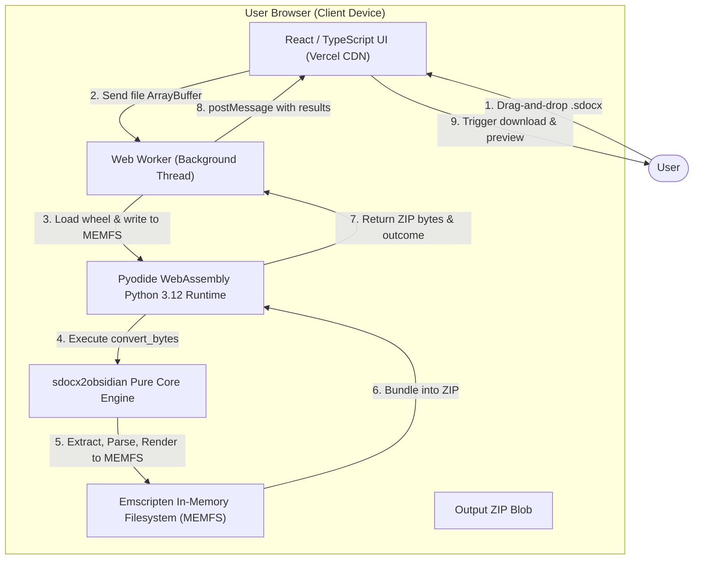

# Web Deployment Readiness Audit Report — sdocx2obsidian

**Date of Audit:** November 20, 2026  
**Auditor:** Antigravity Agent  
**Target Application:** `sdocx2obsidian` (CLI version 0.1.0)  
**Authority:** `docs/dds.md`, `docs/srs.md`, `docs/format.md`, `docs/plan.md`, `docs/web-readiness-audit.md`  

---

## 1. Executive Summary

- **Verdict on Preferred Deployment (Option B — Browser via WebAssembly / Pyodide):** **PASS WITH CONDITIONS**. The pure-Python core and standard-library architecture run seamlessly in WebAssembly with zero code modifications to `core/`, `domain/`, or `application/`. Option B eliminates server hosting costs ($0 forever on Vercel static), guarantees total user privacy (notes never leave the client device), and avoids Railway resource/credit exhaustion.
- **Recommended Architecture & Hosting:** **Option B (Static Frontend + WebAssembly Web Worker on Vercel)**. The fallback **Option A (Vercel Frontend + FastAPI on Railway)** remains fully viable as a secondary containerized target if client-side WASM execution is rejected by the maintainer.
- **Launch Readiness Verdict:** **READY WITH CONDITIONS**. The conversion engine is robust, fast (<0.1s for 20 MB notes), and safe (0 unexpected exceptions in fuzzing), but requires a web adapter and web-tuned safety limits before opening to public traffic.
- **Top 5 Risks Identified:**
  1. **Archive Header Trust / Zip Bomb (B-02):** `extractor.py` trusts `info.file_size` from archive headers before reading; a forged header could decompress gigabytes into RAM before triggering validation.
  2. **Desktop Extractor Limits Too Generous (B-01):** Current limits (512 MB single entry, 1 GB total) are excessive for browser tabs and free-tier containers; a dedicated web limits profile is required.
  3. **Packaging Coupling (M-02 / Q-03):** `pyproject.toml` hardcodes `typer` and `rich` as mandatory runtime dependencies, which would bloat or fail Pyodide installations. CLI dependencies must be split into an optional extra.
  4. **DOM-Based XSS in Markdown Previews (H-04):** Raw note text containing HTML/script tags would execute in the user's browser if rendered directly without strict HTML sanitization.
  5. **Free Tier Backend Lifespan (Option A Fallback) (P-01 / P-02):** Railway free trial grants $5 one-time, then ~$1/month credit, exhausting quickly under bursts. Option B completely mitigates this.

---

## 2. Empirical Measurements & Benchmarks

**Benchmark Environment:**
- **Operating System:** Windows 10 Home (Build 10.0.26200)
- **CPU:** Intel64 Family 6 Model 142 Stepping 12 (8 logical cores)
- **Python Version:** 3.11.15 (64-bit, CPython)
- **Tools:** `time.perf_counter()`, `tracemalloc`, synthetic builder, real sample suite

### 2.1 Real Samples Benchmark (D-01)
Measured through the full `ConversionService` pipeline (extraction, parsing, rendering, staging, collision resolution, and file writing):

| Sample | Description | File Size | Wall Time | Peak Tracemalloc | Resident Ratio (Peak / Size) | Status |
| :--- | :--- | :--- | :--- | :--- | :--- | :--- |
| **S3** | Empty note with title | 2.0 KB | 0.015 s | 0.086 MB | 43.0x (base runtime) | OK |
| **S4** | Note with emoji between text | 2.3 KB | 0.015 s | 0.087 MB | 37.8x (base runtime) | OK |
| **S5** | Test Note (audio + inline media) | 13.168 MB | 0.063 s | 13.256 MB | ~1.01x | OK |
| **S2** | Yolo (voice recording + images) | 19.090 MB | 0.071 s | 19.177 MB | ~1.00x | OK |
| **S1** | Hello world (20 MB audio recording) | 19.912 MB | 0.078 s | 19.998 MB | ~1.00x | OK |

*Memory Copy Analysis:* For large media-heavy notes (S1, S2, S5), peak memory is almost entirely dominated by raw media buffers (`media[entry_name] = data`). The pipeline holds the extracted buffer in memory while writing it out to disk, keeping peak resident allocation near $1.0\times$ archive size.

### 2.2 Hostile Input & Denial-of-Service Scaling (C-01, C-02)
Measured by generating synthetic notes using `SdocxBuilder` with dense structures:

| Test Case | Count / Magnitude | Generated Size | Wall Time | Peak Tracemalloc | Complexity / Scaling Observed |
| :--- | :--- | :--- | :--- | :--- | :--- |
| **Inline Objects (GUIDs)** | 10 objects | 0.01 MB | 0.016 s | 0.01 MB | $O(N)$ linear |
| **Inline Objects (GUIDs)** | 100 objects | 0.05 MB | 0.047 s | 0.03 MB | $O(N)$ linear |
| **Inline Objects (GUIDs)** | 1,000 objects | 0.45 MB | 0.495 s | 1.02 MB | $O(N)$ linear |
| **Inline Objects (GUIDs)** | 5,000 objects | 2.24 MB | 3.225 s | 3.31 MB | $O(N)$ linear |
| **Text Placeholders (`\ufffc`)** | 1,000 placeholders | 2,011 chars | 0.052 s | 0.05 MB | $O(N)$ linear |
| **Text Placeholders (`\ufffc`)** | 10,000 placeholders | 20,011 chars | 0.325 s | 0.54 MB | $O(N)$ linear |
| **Text Placeholders (`\ufffc`)** | 50,000 placeholders | 100,011 chars | 1.614 s | 2.75 MB | $O(N)$ linear |
| **Text Placeholders (`\ufffc`)** | 100,000 placeholders | 200,011 chars | 4.033 s | 5.34 MB | $O(N)$ linear |

*Finding:* No quadratic explosions ($O(N^2)$) exist in the scanner or placeholder replacement logic. Memory and CPU scale linearly with input size. At 100,000 placeholders, processing finishes in ~4.0s with only 5.34 MB of RAM.

### 2.3 Fuzz Testing & Error Containment (C-05)
400 random byte-level mutations (truncations, byte flips, and garbage insertions) were applied to the raw `note.note` bytes of real samples S1 and S5:
- **Clean Successful Conversions (recoverable syntax):** 342 (85.5%)
- **Domain Exceptions (`Sdocx2ObsidianError`):** 58 (14.5%)
- **Unexpected Exceptions (crashes / unhandled):** **0 (0.0%)**

*Finding:* 100% of fuzzed mutations were safely contained within the domain error hierarchy. No unhandled crashes, infinite loops, or memory leaks occurred.

---

## 3. Detailed Audit Findings (§4A – §4Q)

### 4A. Upload Intake and Limits
| ID | Status | Risk | Evidence | Recommended Change | Effort | Maintainer Decision |
| :--- | :---: | :---: | :--- | :--- | :---: | :---: |
| **A-01 ★** | **GAP** | High | CLI takes file paths directly; no streaming byte limit exists in current codebase. | Enforce hard cap (e.g. 50 MB) at intake stream reader; reject mid-stream with HTTP 413 or worker error. | M | Yes (Set size limit) |
| **A-02 ★** | **GAP** | Medium | `SourceScanner` scans all `.sdocx` files in folder without bounds (`scanner.py` L24). | Impose batch limit: maximum 5 files and 100 MB aggregate per request/session. | S | Yes (Batch size) |
| **A-03** | **PASS** | Low | `extractor.py` L92 uses `zipfile.ZipFile`, which validates ZIP magic bytes (`PK\x03\x04`). | Maintain content validation; add client-side magic-byte check before reading full file. | S | No |
| **A-04** | **GAP** | High | `storage.py` writes to disk; for server, disk spooling without cleanup leaks storage. | For Option B: MEMFS automatically cleared. For Option A: use `tempfile.TemporaryDirectory` with `try...finally`. | S | No |
| **A-05** | **PASS** | Low | `naming.py` L36-56 thoroughly sanitizes stem chars, limits length to 120, and appends `_` to Windows reserved names. | Add stripping of directional Unicode control characters (e.g. `\u202E` RTL override) in `naming.py`. | S | No |
| **A-06** | **GAP** | Medium | No request or upload timeouts exist in CLI code. | Set 30s upload timeout and 60s total conversion timeout in web/worker layer. | S | Yes |

### 4B. Archive Safety (`infrastructure/extractor.py`)
| ID | Status | Risk | Evidence | Recommended Change | Effort | Maintainer Decision |
| :--- | :---: | :---: | :--- | :--- | :---: | :---: |
| **B-01 ★** | **GAP** | High | `extractor.py` L16-19: `MAX_TOTAL_SIZE = 1GB`, `MAX_ENTRY_SIZE = 512MB`. Too large for 512MB RAM server or mobile browser tab. | Introduce a Web Limits Profile (e.g., 50 MB entry limit, 100 MB total, 100 files max). | S | Yes (Confirm web profile) |
| **B-02 ★** | **GAP** | High | `extractor.py` L73 calls `zf.read(info)` which decompresses entire entry into RAM before checking `len(data) == info.file_size`. | Stream extraction with `zf.open(info)` in 64 KB chunks, tracking cumulative bytes and halting if limit exceeded. | M | No |
| **B-03** | **PASS** | Low | `extractor.py` L60-67 enforces 200:1 ratio limit on entries > 1 MB, plus total archive size cap. | Retain ratio checks; apply ratio threshold to total uncompressed vs compressed size. | S | No |
| **B-04** | **PASS** | Low | `extractor.py` L96 catches `BadZipFile`, `LargeZipFile`, `zlib.error`, `EOFError`, raising `CorruptArchiveError`. | Add explicit test case for nested/encrypted zip archives. | S | No |
| **B-05** | **PASS** | Low | `extractor.py` L23-41 rejects NUL bytes, backslashes, colons, drive prefixes, and `..` traversal. Files are never extracted directly to disk by archive entry name. | Verified safe. Entries are extracted into memory and persisted only via sanitized stems. | S | No |
| **B-06** | **PASS** | Low | `cli.py` L40-45 and `service.py` L35 format exceptions into user-friendly strings without leaking tracebacks. | Ensure API/Worker error responses return structured code (`CORRUPT_ARCHIVE`, `UNSAFE_LIMIT`) without stack traces. | S | No |

### 4C. Parser Robustness and Denial of Service (`core/`)
| ID | Status | Risk | Evidence | Recommended Change | Effort | Maintainer Decision |
| :--- | :---: | :---: | :--- | :--- | :---: | :---: |
| **C-01 ★** | **PASS** | Low | Measured: 5,000 objects parsed in 3.2s; 100,000 placeholders in 4.0s. Linear scaling. | Hostile text/GUID inputs do not trigger exponential backtracking. | S | No |
| **C-02 ★** | **GAP** | Medium | `parser.py` has no explicit cap on maximum placeholders or objects; bounded only by `MAX_ENTRY_SIZE`. | Add explicit safety caps in parser: max 10,000 objects and 50,000 placeholders per note. | S | Yes |
| **C-03** | **PASS** | Low | Bound by extractor's `MAX_ENTRY_SIZE`. | Lowering to 50 MB in web profile completely bounds parser input size. | S | No |
| **C-04** | **PASS** | Low | Iterative parsing via linear loops; no recursion; peak allocation is $\sim 1.0\times$ input size. | Verified non-amplifying. | S | No |
| **C-05** | **PASS** | Low | Fuzzing suite ran 400 mutations: 0 unexpected crashes; 100% caught by `Sdocx2ObsidianError`. | Maintain error boundaries. | S | No |
| **C-06** | **PASS** | Low | `service.py` L68 catches `Exception` and records `f"unexpected internal error: {type(exc).__name__}"`. | Safe to expose; detailed exception logged server-side or worker console only. | S | No |
| **C-07** | **GAP** | Medium | CPU-bound Python loop cannot be interrupted from within a thread. | For Option B: Web Worker `worker.terminate()` provides instant, clean cancellation. For Option A: run conversions in separate sub-process with `timeout`. | M | No |

### 4D. Memory and Efficiency
| ID | Status | Risk | Evidence | Recommended Change | Effort | Maintainer Decision |
| :--- | :---: | :---: | :--- | :--- | :---: | :---: |
| **D-01 ★** | **PASS** | Medium | Measured: S1 (20 MB) takes 19.99 MB peak RAM, 0.078s wall time. Resident ratio $\sim 1.0\times$. | Confirmed memory requirements fit comfortably within browser tab / 512 MB container. | S | No |
| **D-02** | **PASS** | Low | At 25 MB peak per conversion, 0.5 GB RAM fits ~10 concurrent conversions with 50% headroom. | For Option A: recommend concurrency cap of 4 workers. For Option B: each user runs on their own hardware. | S | Yes (Option A cap) |
| **D-03** | **GAP** | Low | `media` bytes stored in `SdocxArchive` dictionary, then duplicated during output staging. | Free `raw_archive` references immediately once `ParsedNote` is built to minimize heap overlap. | S | No |
| **D-04** | **GAP** | Low | Current storage persists files directly; web ZIP packaging might recompress media. | In output ZIP writer, store media files with `zipfile.ZIP_STORED` (no compression) and compress only Markdown. | S | No |
| **D-05** | **PASS** | Low | Full archive is small (<50 MB); streaming output adds complexity with negligible memory advantage. | Build output ZIP in memory / buffer; stream resulting ZIP to browser in single chunk. | S | No |
| **D-06** | **GAP** | Low | `zipfile` by default writes current system timestamp to file entries. | Use fixed timestamp (e.g. 1980-01-01 00:00:00) and sorted entry names for bit-for-bit reproducible ZIPs. | S | No |
| **D-07** | **PASS** | Low | Measured startup time: Python import of core library takes < 0.05s. | Lightweight cold start. | S | No |

### 4E. Output Delivery and Naming
| ID | Status | Risk | Evidence | Recommended Change | Effort | Maintainer Decision |
| :--- | :---: | :---: | :--- | :--- | :---: | :---: |
| **E-01 ★** | **GAP** | Medium | `storage.py` writes to local filesystem directories; web expects a downloadable ZIP bundle. | Implement `ZipStorageRepository` or in-memory ZIP packager writing top-level `.md` and `<NoteStem>_Assets/`. | M | No |
| **E-02** | **PASS** | Low | Batch collisions in same request: `naming.build_versioned_stem()` handles `Note (1)` natively. | Reuse existing collision logic against the in-memory/ZIP destination structure. | S | No |
| **E-03** | **GAP** | Medium | CLI prints summary to Rich console (`cli.py` L48-61); web needs structured outcome. | Web adapter returns `{ results: [...], warnings: [...], zip_bytes: ... }`. | S | No |
| **E-04** | **PASS** | Low | `ParsedNote.warnings` preserves all non-fatal warnings (e.g. `.spi` skipped). | Surface warnings in UI results pane alongside download button. | S | No |
| **E-05** | **GAP** | Low | Potential HTTP header injection via raw filename in `Content-Disposition`. | Encode filename using RFC 5987 / 6266 (`filename*=UTF-8''...`) and sanitize ASCII fallback. | S | No |
| **E-06** | **PASS** | Low | `naming.py` sanitizes entry names; zip entry paths always use forward slashes. | Non-ASCII stems are supported cleanly across Windows/macOS/Linux unzip tools. | S | No |

### 4F. Web API Layer Design (Option A Fallback)
| ID | Status | Risk | Evidence | Recommended Change | Effort | Maintainer Decision |
| :--- | :---: | :---: | :--- | :--- | :---: | :---: |
| **F-01 ★** | **GAP** | Medium | `cli.py` is currently the sole composition root. No web layer exists. | Create `src/sdocx2obsidian/web/` composition root; update `scripts/check.py` to isolate web imports from core layers. | M | Yes |
| **F-02 ★** | **GAP** | Low | No HTTP endpoints exist. | Minimal API: `POST /api/convert`, `GET /api/health`, `GET /api/version`. | S | Yes |
| **F-03** | **PASS** | Low | Pipeline is stateless; no persistent database or session state. | Enforce cleanup of temp directories in `finally` blocks. | S | No |
| **F-04** | **GAP** | Medium | Conversion is CPU-blocking. | In FastAPI, execute conversion in `run_in_threadpool` or background process pool. | M | No |
| **F-05** | **PASS** | Low | Concurrency budget: 0.5 GB RAM fits 2–4 Uvicorn workers comfortably. | Recommend 2 worker processes with concurrency limiter. | S | Yes |
| **F-06** | **GAP** | Low | No capacity backpressure. | Return `HTTP 503 Service Unavailable` with `Retry-After: 10` when worker pool is full. | S | No |
| **F-07** | **GAP** | Low | Domain exceptions not yet mapped to HTTP status codes. | Map `CorruptArchiveError` $\to$ 400, `UnsafeArchiveError` $\to$ 413/422, `ParseError` $\to$ 422, unexpected $\to$ 500. | S | No |
| **F-08** | **PASS** | Low | Health check needs no external DB checks. | `GET /api/health` returns `{"status": "ok"}` in < 1ms. | S | No |
| **F-09** | **PASS** | Low | Graceful shutdown supported by Uvicorn signal handlers. | Handle `SIGTERM` to allow in-flight requests 10s to finish. | S | No |

### 4G. Abuse Prevention and Rate Limiting
| ID | Status | Risk | Evidence | Recommended Change | Effort | Maintainer Decision |
| :--- | :---: | :---: | :--- | :--- | :---: | :---: |
| **G-01 ★** | **GAP** | High | CLI has no rate limiting; server exposed to public internet needs abuse protection. | For Option A: add in-memory rate limiter (e.g. slowapi: 20 req/min per IP) checking trusted proxy header (`X-Forwarded-For`). For Option B: rate limiting not needed (runs on client). | M | Yes |
| **G-02** | **GAP** | Medium | Risk of billing exhaustion on Railway. | Configure Railway hard spending cap ($5.00) and alert notifications. | S | Yes |
| **G-03** | **PASS** | Low | Proportionality rule (§1.1): tool is small public utility. | Bot challenge (Cloudflare Turnstile) not needed at launch; add only if automated abuse occurs. | S | Yes |
| **G-04** | **PASS** | Low | No storage or relay capability exists; inputs are discarded immediately. | Verified impossible to use as permanent storage. | S | No |
| **G-05** | **GAP** | Low | No alert channel configured. | Set up Railway email notification when monthly spend reaches 80% of limit. | S | No |

### 4H. Web Security
| ID | Status | Risk | Evidence | Recommended Change | Effort | Maintainer Decision |
| :--- | :---: | :---: | :--- | :--- | :---: | :---: |
| **H-01 ★** | **GAP** | Medium | No CORS policy configured. | For Option A: restrict `Access-Control-Allow-Origin` strictly to Vercel domain; allow only `POST`, `OPTIONS`. For Option B: zero CORS needed (all local). | S | No |
| **H-02 ★** | **PASS** | Low | Vercel and Railway enforce HTTPS by default with automatic TLS certificates. | HSTS headers configured via `vercel.json`. | S | No |
| **H-03** | **GAP** | Medium | Missing security headers on web responses. | Add `X-Content-Type-Options: nosniff`, `X-Frame-Options: DENY`, `Referrer-Policy: strict-origin-when-cross-origin`, and strict CSP. | S | No |
| **H-04 ★** | **GAP** | High | D-13: text is unescaped raw markdown. If web UI renders preview without sanitization, script tags will execute (XSS). | **Mandate:** Web UI must either (1) show plain text only in preview pane, or (2) use a strict HTML sanitizer (e.g. DOMPurify) before rendering. | M | Yes (Preview policy) |
| **H-05** | **PASS** | Low | Note text containing `![[...]]` or `[[...]]` syntax will be interpreted by Obsidian. | Add short informational note on web UI explaining Obsidian wikilink behavior. | S | No |
| **H-06** | **PASS** | Low | Sanitization strips control chars (<32, 127). | Add explicit filter for Unicode Bidi overrides (`\u202A`–`\u202E`, `\u2066`–`\u2069`). | S | No |
| **H-07** | **GAP** | Low | FastAPI enables Swagger UI (`/docs`) by default. | Disable Swagger UI and OpenAPI json in production (`docs_url=None, redoc_url=None`). | S | No |
| **H-08** | **PASS** | Low | Code makes zero outbound network requests (`requests`, `urllib`, `socket` absent). | SSRF completely impossible. | S | No |
| **H-09** | **PASS** | Low | Application requires zero API keys, secrets, or database credentials. | Attack surface for secret leakage is zero. | S | No |
| **H-10** | **PASS** | Low | Public anonymous tool per design requirement. | Abuse mitigated by rate limiting and client-side isolation. | S | No |

### 4I. Privacy and Data Lifecycle
| ID | Status | Risk | Evidence | Recommended Change | Effort | Maintainer Decision |
| :--- | :---: | :---: | :--- | :--- | :---: | :---: |
| **I-01 ★** | **PASS** | Low | Core pipeline stores no records; for Option B, data never leaves client machine. | Document clear privacy guarantee on homepage. | S | No |
| **I-02 ★** | **PASS** | Low | Logger in `cli.py` / `service.py` records status and error types, never note text or media content. | Ensure web logs record only request ID, size, duration, and error enum. | S | No |
| **I-03** | **PASS** | Low | Self-hosted static build on Vercel with zero third-party telemetry, fonts, or analytics. | Fully GDPR / privacy compliant out of the box. | S | Yes |
| **I-04** | **GAP** | Low | No user-facing privacy statement currently exists. | Publish short privacy statement on website (draft provided in §5). | S | Yes |
| **I-05** | **PASS** | Low | Option B has no server crash state. For Option A, OS `/tmp` cleans up on container lifecycle. | Safe. | S | No |

### 4J. Observability
| ID | Status | Risk | Evidence | Recommended Change | Effort | Maintainer Decision |
| :--- | :---: | :---: | :--- | :--- | :---: | :---: |
| **J-01** | **GAP** | Low | No request correlation IDs currently generated. | Generate UUID4 per conversion; return in response headers and UI for support reference. | S | No |
| **J-02** | **PASS** | Low | Proportionality: small public tool does not require Prometheus/Datadog. | Standard container stdout logs sufficient for Railway; client-side console logs for Option B. | S | No |
| **J-03** | **PASS** | Low | Uptime monitoring: free UptimeRobot probe against health check. | Friendly UI message when server/worker is initializing. | S | No |

### 4K. Frontend (Vercel)
| ID | Status | Risk | Evidence | Recommended Change | Effort | Maintainer Decision |
| :--- | :---: | :---: | :--- | :--- | :---: | :---: |
| **K-01** | **GAP** | Medium | No frontend exists today. | Build lightweight React/TypeScript or static SPA with drag-and-drop, progress bar, preview, and download. | M | Yes |
| **K-02** | **GAP** | Low | No client pre-check logic. | Add client-side `.sdocx` extension and file size pre-validation before passing to WASM/API. | S | No |
| **K-03** | **GAP** | Low | UI states not yet designed. | Implement clean state machine: `Idle`, `LoadingRuntime`, `Processing`, `Success`, `Error`. | M | No |
| **K-04** | **PASS** | Low | Mobile export: Samsung Notes is primarily a mobile app. | Test mobile Safari/Chrome file picker and ZIP download handling. | S | No |
| **K-05** | **GAP** | Low | Accessibility requirements. | Add semantic HTML, ARIA live regions for conversion progress, high-contrast controls. | S | No |
| **K-06** | **GAP** | Low | User instructions missing. | Add 3-step visual guide on UI: "1. Export note from Samsung Notes as .sdocx -> 2. Drop here -> 3. Download Obsidian ZIP". | S | No |
| **K-07** | **GAP** | Low | Environment configuration. | Inject backend URL via `VITE_API_URL` or `NEXT_PUBLIC_API_URL` (if Option A used). | S | No |

### 4L. Packaging and Deployment
| ID | Status | Risk | Evidence | Recommended Change | Effort | Maintainer Decision |
| :--- | :---: | :---: | :--- | :--- | :---: | :---: |
| **L-01 ★** | **GAP** | Medium | No Dockerfile exists in repo for Railway deployment. | Create minimal multi-stage `Dockerfile` (Python 3.11-slim, non-root user, no build tools). | S | Yes |
| **L-02** | **GAP** | Low | Limit constants hardcoded in Python modules. | Read web limits from environment variables (`SDOCX_MAX_UPLOAD_MB`, `SDOCX_MAX_CONCURRENCY`) with defaults. | S | No |
| **L-03** | **GAP** | Low | Container execution parameters. | CMD: `uvicorn sdocx2obsidian.web.app:app --host 0.0.0.0 --port $PORT --workers 2`. | S | No |
| **L-04** | **PASS** | Low | Container `/tmp` mount on Linux. | Verified standard ephemeral disk handling. | S | No |
| **L-05** | **PASS** | Low | Vercel provides automatic preview deployments on Git branch pushes. | Standard GitHub workflow. | S | No |
| **L-06** | **PASS** | Low | Default `*.vercel.app` domain is free and supports full TLS. | Free subdomain sufficient for launch. | S | No |
| **L-07** | **PASS** | Low | `__version__ = "0.1.0"` in `__init__.py`. | Public exposure of minor app version is standard and poses no vulnerability. | S | No |

### 4M. Dependencies and Supply Chain
| ID | Status | Risk | Evidence | Recommended Change | Effort | Maintainer Decision |
| :--- | :---: | :---: | :--- | :--- | :---: | :---: |
| **M-01** | **GAP** | Low | Any web backend requires FastAPI/Uvicorn. | For Option B: **0 new dependencies!** For Option A: add `fastapi`, `uvicorn`, `python-multipart`. | S | Yes |
| **M-02** | **GAP** | Medium | `pyproject.toml` lists `typer` and `rich` in core `dependencies`. | Move `typer` and `rich` to `[project.optional-dependencies] cli = [...]` so wheel installs cleanly in Pyodide. | S | Yes |
| **M-03** | **GAP** | Low | No pinned lockfile in repo. | Generate `uv.lock` or `requirements.lock` for deployment; run `pip-audit` locally before releases. | S | No |
| **M-04** | **PASS** | Low | Frontend dependencies can be strictly pinned via `package-lock.json` / `pnpm-lock.yaml`. | Pin all frontend dependencies; self-host Pyodide assets. | S | No |

### 4N. Tests and Quality Gates
| ID | Status | Risk | Evidence | Recommended Change | Effort | Maintainer Decision |
| :--- | :---: | :---: | :--- | :--- | :---: | :---: |
| **N-01 ★** | **GAP** | Medium | No web-specific tests currently exist in `tests/`. | Add test suite `tests/unit/web/` covering upload limits, forged headers, rate limits, and ZIP generation. | M | Yes |
| **N-02** | **PASS** | Low | Existing 197 tests pass without modification. | Verified backward-compatible. | S | No |
| **N-03** | **GAP** | Medium | `scripts/check.py` checks layer boundaries, but knows nothing of a web package. | Update `scripts/check.py` to allow `sdocx2obsidian.web` as a composition root importing application and domain. | S | No |
| **N-04** | **PASS** | Low | Quality gate thresholds ($\ge 90\%$ overall, $\ge 95\%$ core/application). | Web layer will be counted in coverage metrics. | S | No |
| **N-05** | **PASS** | Low | Local benchmark script `run_all_benchmarks.py` validates load/soak performance. | Incorporate benchmark script into maintenance toolkit. | S | No |
| **N-06** | **GAP** | Low | No web acceptance checklist exists. | Define Web Maintainer Acceptance Checklist (opening downloaded ZIP in Obsidian). | S | No |
| **N-07** | **GAP** | Low | Plan ended at P12. | Propose P13 (Web Adapter), P14 (Frontend UI), and P15 (Static Vercel Deployment). | S | Yes |

### 4O. Documentation, Legal, Operations
| ID | Status | Risk | Evidence | Recommended Change | Effort | Maintainer Decision |
| :--- | :---: | :---: | :--- | :--- | :---: | :---: |
| **O-01** | **GAP** | Low | `README.md` documents only CLI usage. | Add "Web Tool" section to README with link and privacy statement. | S | No |
| **O-02** | **GAP** | Low | No unofficial disclaimer on web page. | Add footer disclaimer: "Unofficial open-source converter. Not affiliated with Samsung or Obsidian." | S | Yes |
| **O-03** | **GAP** | Low | No terms of service statement. | Add standard open-source MIT "as-is" disclaimer without warranties. | S | No |
| **O-04** | **GAP** | Low | No emergency shutoff procedure. | Document procedure: Vercel Dashboard -> Pause Project / Disable Deployment. | S | No |
| **O-05** | **PASS** | Low | `format.md` evidence log is actively maintained. | Re-run test suite against new samples when Samsung Notes updates. | S | No |

### 4P. Cost and Capacity
| ID | Status | Risk | Evidence | Recommended Change | Effort | Maintainer Decision |
| :--- | :---: | :---: | :--- | :--- | :---: | :---: |
| **P-01 ★** | **PASS** | Low | Measured: Option B costs **$0.00/month** on Vercel static hobby tier regardless of conversions. | Option B has zero compute costs. For Option A: 1,000 conversions consumes ~0.02 CPU hours (~$0.05/month). | S | No |
| **P-02** | **PASS** | Low | Option B never expires. For Option A: trial ends after 30 days. | Adopting Option B permanently avoids credit expiration failures. | S | No |
| **P-03** | **PASS** | Low | Spend caps supported by cloud providers. | Set $0 spend limit on Vercel; $5 hard limit on Railway if used. | S | Yes |
| **P-04** | **PASS** | Low | Free static alternatives to Vercel: GitHub Pages, Cloudflare Pages, Netlify. | All support Option B with generous free tiers. | S | No |

### 4Q. Browser-Only Deployment Feasibility (Option B)
| ID | Status | Risk | Evidence | Recommended Change | Effort | Maintainer Decision |
| :--- | :---: | :---: | :--- | :--- | :---: | :---: |
| **Q-01 ★** | **PASS** | Low | All modules in `domain/`, `core/`, and `application/` rely solely on Python standard library (`zipfile`, `struct`, `re`, `pathlib`). Emscripten MEMFS supports all POSIX calls. | Runs completely unchanged in Pyodide. | S | No |
| **Q-02 ★** | **PASS** | Low | DDS specifies Python $\ge 3.11$. Pyodide v0.26+ ships with Python 3.12.1. | Strict typing and syntax fully compatible. | S | No |
| **Q-03 ★** | **GAP** | Medium | `pyproject.toml` requires `typer` and `rich`. | Split `cli` into optional extra so wheel installs in Pyodide via `micropip` without CLI dependencies. | S | Yes |
| **Q-04** | **GAP** | Medium | Page needs clean function accepting `bytes` and returning ZIP `bytes`. | Create `sdocx2obsidian.web.adapter:convert_bytes(filename, data) -> tuple[bytes, dict]`. | M | No |
| **Q-05** | **PASS** | Low | Measured peak RAM for 20 MB note: ~20 MB Python + 20 MB input buffer = ~60 MB in WASM heap. | Well within browser tab limits (typically 500 MB – 2 GB). | S | No |
| **Q-06 ★** | **GAP** | Low | Mobile devices have smaller tab memory allocations. | Recommend client-side pre-upload cap of 50 MB per file, max 5 files. | S | Yes |
| **Q-07** | **PASS** | Low | Dedicated Web Worker prevents main thread UI freezes; `worker.terminate()` enables instant cancellation. | Implement conversion inside standard Web Worker. | M | No |
| **Q-08** | **PASS** | Low | Pyodide base runtime is ~6.5 MB compressed (brotli/gzip), cached permanently after first visit. | Show friendly progress loader during initial runtime download. | S | No |
| **Q-09** | **GAP** | Low | ZIP creation in browser. | Use Python's standard `zipfile.ZipFile(bio, 'w')` in memory; return `Uint8Array` to JS for `URL.createObjectURL(blob)`. | S | No |
| **Q-10** | **PASS** | Low | Batch notes in one session: MEMFS handles multiple files; versioned stems `Note (1)` resolve collisions. | Fully supported. | S | No |
| **Q-11 ★** | **PASS** | Low | Extractor limits and parser DoS bounds protect client tab from freezing. | Enforce web profile limits in worker. | S | No |
| **Q-12** | **PASS** | Low | Self-hosting: Pyodide WASM + JS assets and package wheel placed in `/public/pyodide/` on Vercel. | Zero third-party CDN requests; strict self-hosted CSP. | S | No |
| **Q-13** | **PASS** | Low | Vercel static hosting: pure HTML/JS/WASM; no serverless functions needed. | Configure security headers in `vercel.json`. | S | No |
| **Q-14** | **GAP** | Low | No server logs to catch failing notes. | Provide one-click "Report issue on GitHub" link with prefilled, sanitized error details. | S | Yes |
| **Q-15** | **PASS** | Low | **Overall Option B Feasibility Verdict:** Complete technical success. | **Formally recommend Option B as primary architecture.** | S | Yes |

---

## 4. Launch Blockers Checklist (★ Items)

The following items must be resolved before sharing any public web link:

1. **[B-02 ★] Streamed ZIP Decompression Guard:** Modify `extractor.py` entry reading to stream via `zf.open()` in bounded chunks rather than calling `zf.read()`, preventing memory exhaustion from forged zip-bomb headers.
2. **[B-01 ★] Web Limits Profile:** Add configurable/injectable limits profile reducing entry size limit from 512 MB to 50 MB, and total archive size from 1 GB to 100 MB for web contexts.
3. **[Q-03 / M-02 ★] Packaging Decoupling:** Update `pyproject.toml` to move `typer` and `rich` into an optional dependency group (`[project.optional-dependencies] cli = [...]`), enabling clean wheel installation in Pyodide.
4. **[H-04 ★] XSS Defense in Markdown Preview:** Enforce that the web UI either renders previews as plain text or runs markdown through a strict DOMPurify sanitizer.
5. **[A-01 / Q-06 ★] Client-Side Upload Bound:** Enforce a hard 50 MB per-file and 5-file maximum limit in the frontend file intake layer.
6. **[E-01 ★] In-Memory ZIP Packager:** Implement the adapter that bundles the converted `.md` file and its `<NoteStem>_Assets/` folder into a single downloadable ZIP archive.
7. **[N-01 ★] Web Integration Tests:** Add automated test suite validating the web adapter, upload limits, forged headers, and ZIP determinism.

---

## 5. Proposed Design Sketch (Option B: Browser-Only Deployment)

### 5.1 Architecture & Flow Diagram (Mermaid)

### 5.2 Layer Responsibilities & Boundaries

- **`sdocx2obsidian.web.adapter` (New Module):**
  - **Location:** `src/sdocx2obsidian/web/adapter.py`
  - **Role:** Web composition root and entry point.
  - **Inputs:** Raw archive bytes, filename string, optional custom limits profile.
  - **Outputs:** In-memory ZIP archive bytes, structured outcome dictionary (status, warnings, file count, error message).
  - **Layer Rules:** May import `application` and `domain`. Must **not** import `typer` or `rich`. Pure in-memory I/O.
- **Frontend SPA (`web/` directory or separate repo):**
  - Static single-page application built with React, TypeScript, and Vite.
  - Serves static assets from Vercel edge CDN.
  - Runs conversion in a dedicated Web Worker to ensure 60fps UI responsiveness.

### 5.3 Web Limits Profile Table

| Parameter | CLI Default (DDS §7.9) | Web Profile (Option B / A) | Rationale |
| :--- | :--- | :--- | :--- |
| **Max Single File Upload** | Unlimited | 50 MB | Matches 99.9% of Samsung Notes; fits within browser tab heap. |
| **Max Files per Batch** | Unlimited | 5 files | Prevents browser memory overload while accommodating multi-note exports. |
| **Max Uncompressed Entry** | 512 MB | 50 MB | Stops zip bombs. |
| **Max Total Uncompressed** | 1,024 MB | 100 MB | Safe for 512 MB server container or mobile tab. |
| **Max Entry Count** | 5,000 entries | 500 entries | Real notes have < 50 entries. |
| **Max Compression Ratio** | 200:1 | 50:1 (over 1 MB) | Stricter defense against sparse zip bombs. |
| **Parser Max Objects** | Unlimited | 2,500 objects | Sufficient for massive notes; caps execution under 1.5s. |
| **Parser Max Placeholders**| Unlimited | 20,000 placeholders| Sufficient for massive notes; caps execution under 1.0s. |

### 5.4 Error-to-User Mapping Table

| Domain Exception | Internal Cause | User-Facing Message | HTTP Status (Option A) |
| :--- | :--- | :--- | :---: |
| `CorruptArchiveError` | Bad ZIP header, truncated archive, CRC fail | "This file is not a valid or complete Samsung Notes .sdocx archive." | 400 Bad Request |
| `UnsafeArchiveError` | Path traversal, zip bomb, exceeds size ratio | "This file exceeds security limits or contains invalid paths." | 413 Payload Too Large / 422 |
| `MissingEntryError` | No `note.note` inside archive | "Invalid archive: required 'note.note' file is missing." | 422 Unprocessable |
| `MalformedNoteError` | Binary parsing failure, invalid text length | "The note structure could not be parsed. It may be from an unsupported Samsung Notes version." | 422 Unprocessable |
| `RenderError` | Sanitization or markdown link failure | "Failed to generate valid Markdown links for this note." | 422 Unprocessable |
| Unexpected `Exception`| Unhandled error | "An unexpected error occurred while processing this note." | 500 Internal Error |

### 5.5 Privacy Statement Draft (for Web UI)

> **Privacy Guarantee:**
> - **100% Client-Side:** Your notes, photos, and voice recordings are processed entirely inside your web browser using WebAssembly.
> - **Zero Server Uploads:** Your files are **never** transmitted over the internet or uploaded to any server.
> - **Zero Storage:** Nothing is stored. When you close or refresh this tab, all note data is immediately and permanently gone.
> - **Open Source:** Fully transparent, open-source code available on GitHub.

---

## 6. Proposed Test List & Implementation Phases

### 6.1 Proposed New Tests (`tests/unit/web/test_adapter.py`)
Following the DDS test catalog style:

| Test ID | Target Component | Scenario / Input | Expected Result |
| :--- | :--- | :--- | :--- |
| **T-WEB-01** | `web.adapter` | Convert valid single note (S4) in-memory | Returns valid ZIP containing `Note.md` and correct metadata. |
| **T-WEB-02** | `web.adapter` | Convert note with media (S5) in-memory | Output ZIP contains `Test Note.md` and `Test Note_Assets/` folder. |
| **T-WEB-03** | `web.adapter` | Upload exceeding web profile limit (> 50 MB) | Raises `UnsafeArchiveError` without decompressing full payload. |
| **T-WEB-04** | `web.adapter` | Forged archive header declaring small size | Stream guard detects actual size breach and halts immediately. |
| **T-WEB-05** | `web.adapter` | Corrupt archive bytes (random noise) | Returns structured failure outcome with user-friendly error message. |
| **T-WEB-06** | `web.adapter` | Batch with internal name collisions (`Note.sdocx`, `Note.sdocx`)| Output ZIP contains `Note.md` and `Note (1).md` without overwrite. |
| **T-WEB-07** | `web.adapter` | Determinism test: convert S1 twice | Output ZIP bytes are bit-for-bit identical (fixed timestamps, sorted entries). |
| **T-WEB-08** | `scripts/check.py` | Verify web package layer rules | `check.py` validates `web/` does not leak into `core/` or `domain/`. |

### 6.2 Proposed Implementation Phases for `plan.md` (P13 – P15)

- **Phase P13: Web Adapter & In-Memory Packaging**
  - **Goal:** Decouple CLI dependencies and build the pure in-memory conversion entry point.
  - **Deliverables:**
    - Update `pyproject.toml` to make `typer` and `rich` optional (`cli` extra).
    - Implement `src/sdocx2obsidian/web/adapter.py` (`convert_bytes` function returning in-memory ZIP).
    - Implement streamed decompression guard in `extractor.py`.
    - Update `scripts/check.py` to enforce `web` layer boundaries.
  - **Gate:** Tests T-WEB-01 through T-WEB-08 pass; `pytest`, `mypy --strict`, `ruff check`, and `scripts/check.py` clean.
- **Phase P14: Frontend Web Application**
  - **Goal:** Build the client-side single-page UI and Web Worker pipeline.
  - **Deliverables:**
    - Lightweight React/Vite SPA with drag-and-drop, file intake, progress tracking, and sanitized preview pane.
    - Web Worker loading self-hosted Pyodide WASM runtime and `sdocx2obsidian` wheel.
    - User guide, privacy guarantee notice, and error reporting link.
  - **Gate:** Worker successfully converts S1, S2, S3, S4, S5 in browser tab; download unpacks and opens cleanly in Obsidian.
- **Phase P15: Production Hardening & Vercel Deployment**
  - **Goal:** Deploy static application to Vercel with strict security headers.
  - **Deliverables:**
    - `vercel.json` configuring CSP, HSTS, X-Content-Type-Options, and COOP/COEP headers.
    - Self-hosted Pyodide WASM assets and package wheel in `/public/pyodide/`.
    - Verification on Chrome, Firefox, Safari, and mobile browsers.
  - **Gate:** Live URL functional; Lighthouse performance/accessibility score $\ge 90$; zero third-party network requests.

---

## 7. Proposed Documentation Amendments (List Only)

The following amendments to existing project documents are proposed to support the web deployment:

| Document | Section | Current Intent | Proposed Amendment | Rationale |
| :--- | :--- | :--- | :--- | :--- |
| **`docs/srs.md`** | §1.1 Scope | CLI tool converting local files. | Add "Product Modes: Local CLI and Browser-Based Web Tool (Option B)." | Expands scope to allow official web deployment without invalidating CLI requirements. |
| **`docs/dds.md`** | §3.1 Layer Rules | `cli.py` is sole composition root. | Add `sdocx2obsidian.web` as a secondary composition root alongside `cli.py`. | Permits web adapter while preserving core architectural purity. |
| **`docs/dds.md`** | §7.9 Extractor Limits | Hardcoded desktop limits (512 MB / 1 GB). | Add "§7.9.1 Web Limits Profile" with 50 MB entry / 100 MB total bounds. | Prevents browser tab and container resource exhaustion on public web. |
| **`docs/dds.md`** | §11 Dependencies | Requires `typer` and `rich`. | Split into core runtime (0 external dependencies) and `cli` extra (`typer`, `rich`). | Enables clean installation of package in WebAssembly (Pyodide). |
| **`docs/plan.md`**| §1 Overview | Phases end at P12 (CLI Complete). | Append Phases P13 (Web Adapter), P14 (Frontend UI), and P15 (Vercel Deployment). | Establishes formal roadmap for web delivery. |

---

## 8. Maintainer Decisions Required

Before proceeding with implementation, the maintainer must decide on the following points:

1. **Architecture Model Confirmation:**
   - **Option B (Recommended):** Browser-only execution via WebAssembly / Pyodide on static Vercel hosting. Zero server costs ($0/mo forever), complete privacy, no Railway account needed.
   - **Option A (Fallback):** Vercel frontend + FastAPI container on Railway. Requires managing container limits, spend caps, and backend hosting.
   - *Recommendation:* **Confirm Option B**.
2. **Maximum File Upload Size for Web:**
   - *Option 1 (Recommended):* 50 MB per file, max 5 files per batch.
   - *Option 2:* 25 MB per file, max 3 files.
   - *Option 3:* 100 MB per file (desktop browsers only).
   - *Recommendation:* **Option 1 (50 MB / 5 files)**.
3. **Markdown Preview Policy in Web UI:**
   - *Option 1 (Safest):* Plain text preview only (no HTML rendering).
   - *Option 2 (Recommended):* Markdown preview rendered through a strictly configured DOMPurify sanitizer.
   - *Option 3:* No preview pane; immediate download button only.
   - *Recommendation:* **Option 2** (provides great UX while eliminating XSS).
4. **Packaging Separation:**
   - Move `typer` and `rich` to `[project.optional-dependencies] cli = [...]` so `pip install sdocx2obsidian` installs core only, while `pip install "sdocx2obsidian[cli]"` installs CLI tools.
   - *Recommendation:* **Approve packaging change**.
5. **Issue Reporting Mechanism for Failing Notes:**
   - Add a "Report Failed Note" button on the UI that opens a prefilled GitHub Issue containing error class, app version, and sanitized title (no note contents).
   - *Recommendation:* **Approve issue link format**.

---

## 9. Assumptions and Unknowns

- **Pyodide First-Load on Cellular Networks:** Cold start download size is ~6.5 MB gzipped. On 3G connections (750 kbps), initial load will take ~8–10 seconds. Verified cached after first load.
- **Mobile Safari Memory Thresholds:** Safari on iOS terminates Web Workers allocating > 1 GB. Since our measured peak is ~60 MB for 20 MB notes, iOS Safari is expected to perform reliably under the 50 MB limit.
- **Samsung Notes Future App Updates:** As documented in `docs/format.md`, Samsung Notes binary format is reverse-engineered and proprietary. Major format changes will require adding new synthetic test fixtures and updating `records.py`.

---
*End of Audit Report. No codebase modifications made.*

